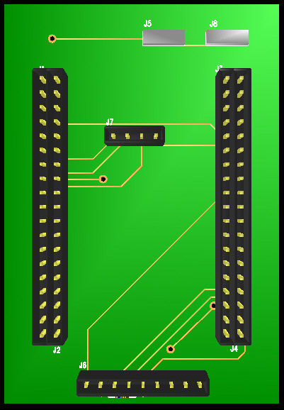

# 基于 STM32F411 的心率检测与波形显示数据采集系统

> Pulse Sensor + STM32F411RET6 + 2.2" SPI TFT 的便携式生理信号采集与显示系统。
> 以 500 Hz 采样光电容积脉搏波（PPG）信号，实时解算心率（BPM）与心搏间期（IBI），
> 在 TFT 上绘制脉搏波形并同步通过 UART 上传给上位机。



---

## 1. 项目概览

| 项目 | 说明 |
| --- | --- |
| 项目性质 | 电子设计竞赛作品 —— 具波形显示功能的数据采集系统 |
| 主控 | STM32F411RET6（ARM Cortex-M4F，512 KB Flash / 128 KB SRAM，LQFP64） |
| 传感器 | Pulse Sensor（光电式脉搏传感器，PPG 模拟输出，3.3 V 供电） |
| 显示 | 2.2 英寸 SPI TFT 模组，240 × 320，ILI9341 控制器 |
| 开发环境 | Keil MDK-ARM 5（ARM-ADS 工具链）、STM32CubeMX 生成 HAL 工程、C99 |
| 上位机 | 通过 USART2 以 115200 bps 输出数据帧，供 Processing / 串口示波器显示 |
| 硬件设计 | Altium Designer（Protel）原理图 + PCB，双列 20 Pin 排针承载核心板 |
| 完成时间 | 2016.08 |

## 2. 系统框图

```
        ┌──────────────────┐        ┌───────────────────────────┐
        │  Pulse Sensor    │        │  2.2" SPI TFT (ILI9341)   │
        │  PPG 模拟输出     │        │  240×320, 4 线 SPI        │
        └────────┬─────────┘        └────────────▲──────────────┘
                 │ S (模拟)                      │ PB0~PB5 软件 SPI
                 ▼                               │
        ┌────────────────────────────────────────┴──────────────┐
        │                 STM32F411RET6                         │
        │                                                       │
        │  ADC1_IN0 (PA0) ──┐                                   │
        │                   ├──► TIM3 中断 @500 Hz (2 ms)       │
        │  TIM3 时基 ───────┘        │                          │
        │                            ├─► 峰值/谷值 + 自适应阈值 │
        │                            ├─► IBI / BPM 解算         │
        │                            └─► 波形绘制 + 数值刷新     │
        │                                                       │
        │  USART2 (PA2/PA3, 115200) ──► 上位机波形显示/记录     │
        │  PA5 ──► 心搏指示 LED                                  │
        └───────────────────────────────────────────────────────┘
```

## 3. 核心功能

- **500 Hz 定频采集**：TIM3 溢出中断驱动，每 2 ms 触发一次 ADC 单次转换，时基同时用于毫秒级计时（`sampleCounter`）。
- **PPG 心率解算**：峰值-谷值跟踪 + 自适应阈值（`thresh = amp/2 + T`）检测心搏，结合二重脉（dichrotic）噪声抑制窗口与 2500 ms 失搏复位，输出 BPM 与 IBI。
- **实时波形显示**：手写 ILI9341 驱动层，以差分线段方式逐点绘制脉搏波形，60 点/整屏（约 120 ms 窗口）滚动刷新。
- **中文/数字 UI**：内置 16×16、32×32 中文字库与 12×8、16×8 ASCII 字库，支持汉字、字符串、数字显示。
- **数据上传协议**：`'S'`（原始波形）/ `'B'`（BPM）/ `'Q'`（IBI）前缀 + ASCII 数值 + CRLF，`printf` 重定向到 USART2。

## 4. 仓库结构

```
.
├── README.md                     # 本文件：项目总览
├── docs/
│   ├── 01-项目梳理.md            # 全量梳理：资料地图、架构、技术点、工程缺口
│   ├── 02-简历模板.md            # ★ 可直接复制进简历的模板（3 种长度 + STAR 版）
│   ├── 03-技术原理与算法.md       # 采样时序、心率算法、显示驱动、通信协议
│   ├── 04-硬件设计与接口.md       # 原理图/PCB/引脚表/接口定义/物料
│   └── 05-面试问答.md            # 高频追问与回答要点
├── firmware/
│   ├── Src/                      # 应用层源码
│   │   ├── main.c                # 主逻辑：LCD 驱动 + 心率算法 + 主循环
│   │   ├── font.h                # 字库（ASCII + 16×16/32×32 汉字点阵）
│   │   ├── stm32f4xx_it.c        # 中断向量（SysTick / TIM3）
│   │   └── stm32f4xx_hal_msp.c   # 外设时钟与引脚复用（ADC/TIM/UART）
│   └── MDK-ARM/                  # Keil 工程文件（.uvprojx / .uvoptx）
└── hardware/
    ├── images/                   # 原理图 / PCB / 效果图
    ├── datasheets/               # TFT 模组与脉搏传感器模块原理图
    └── altium/                   # Altium(Protel) 原始 .Sch / .PCB 源文件
```

## 5. 硬件接口速查

| 功能 | 引脚 | 说明 |
| --- | --- | --- |
| 脉搏信号输入 | PA0 / ADC1_IN0 | 传感器 `S` 脚，10 位分辨率，15 周期采样 |
| TFT 片选 CS | PB4 | 软件 SPI |
| TFT 时钟 SCK | PB3 | 软件 SPI |
| TFT 数据 SDI | PB5 | 软件 SPI（MOSI） |
| TFT 数据/命令 DC | PB1 | 1 = 数据，0 = 命令 |
| TFT 复位 RESET | PB0 | 低电平复位 |
| 串口 TX / RX | PA2 / PA3 | USART2，115200 8N1，AF7 |
| 心搏指示 LED | PA5 | 每检测到一次心搏置位 |

## 6. 说明与致谢

本仓库是对既有竞赛/开源资料的结构化整理，用于技术复盘与作品展示，**不代表全部代码为本人原创**：

- 心率检测算法源自开源项目 [PulseSensor Playground](https://github.com/WorldFamousElectronics/PulseSensorPlayground)（Joel Murphy / World Famous Electronics）的 Arduino 实现，本项目将其移植到 STM32 HAL 平台并适配显示与串口链路。
- 竞赛指定的脉搏传感器模组、2.2 英寸 TFT 模组为第三方成品模块，其原理图见 `hardware/datasheets/`，版权归原厂所有。
- 核心板与模组接口板的原理图/PCB 由本项目完成，源文件见 `hardware/altium/`。

仓库内资料仅供学习交流，如涉及第三方版权请告知删除。
