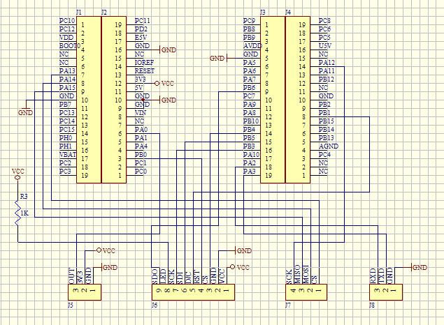
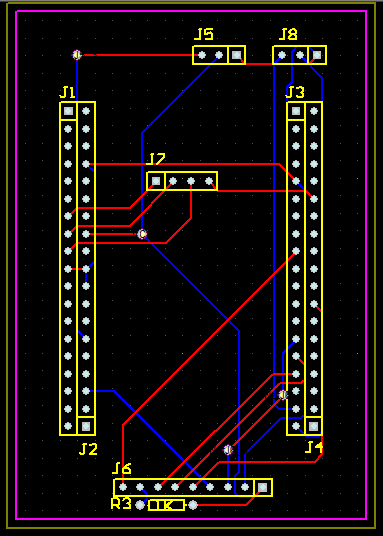
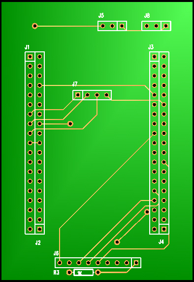
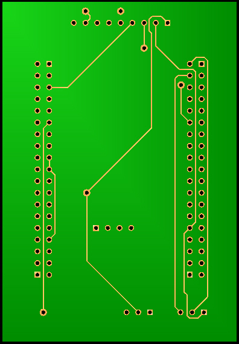

# 硬件设计与接口

> 原始资料中的《硬件设计说明》只有一页，本文在通读原理图（`.Sch`）与 PCB（`.PCB`）后做了完整补全。

---

## 1. 系统组成

本项目采用**"核心板 + 承载底板 + 成品模块"**的搭建方式，而非从零绘制 MCU 最小系统：

| 部分 | 内容 | 来源 |
| --- | --- | --- |
| 主控核心板 | STM32F411RET6（LQFP64，512 KB Flash / 128 KB SRAM，Cortex-M4F） | 现成模块 |
| 承载底板 | 本项目设计的转接板：提供核心板插座与外设接口 | **本项目绘制** |
| 传感模块 | 光电式脉搏传感器（PPG），3.3 V 供电，模拟输出 | 竞赛指定 2 号心率模块 |
| 显示模块 | 2.2 英寸 TFT，240 × 320，ILI9341 控制器，9 Pin 接口 | 现成模块 |

原始《硬件设计说明》原文要点：

> 该系统中关键模块由大赛方提供，心率传感器模块是大赛指定的 2 号心率模块，硬件采用的是现有模块搭建方式。
> 心率传感器采用 3.3 V 供电，心率信号为 AD 输出。
> `'S'` —— 模拟脉搏信号输出，接 F411 的 PA0 引脚；`'+'` —— 5V/3.3V 电源输入；`'-'` —— GND。

---

## 2. 底板的作用

核心板本身只有排针，无法直接插接 TFT 与传感器，因此设计了一块**承载底板**完成三件事：

1. **机械承载**：4 组 20 Pin 排针座（J1–J4）把核心板固定在底板上；
2. **信号转接**：把 TFT、传感器、串口等外设信号与核心板对应引脚连通；
3. **供电与指示**：提供 3.3 V / 5 V 电源分配与电源指示 LED。

原理图与 PCB：





| PCB 正面 | PCB 反面 |
| --- | --- |
|  |  |

> PCB 为单板双面走线，中部大面积留空用于容纳核心板本体与散热。
> 边框外框尺寸可由 `.PCB` 源文件在 Altium/Protel 中直接量取。


---

## 3. 接口定义

> 下表依据原理图逐脚核对整理。（J1–J4 为承载核心板的排针座，其引脚名沿用核心板丝印）

| 接口 | 位数 | 功能 | 引脚定义 |
| --- | --- | --- | --- |
| **J1 / J2** | 20 + 20 | 核心板左侧两排插座 | 引出 PC/PA/PB 各 GPIO，含 Arduino 风格电源标识 `3V3` `5V` `VIN` `GND` `IOREF` `RESET` `E5V` `U5V` `AVDD` `AGND` |
| **J3 / J4** | 20 + 20 | 核心板右侧两排插座 | 同上 |
| **J5** | 3 | 脉搏传感器模块接口 | `OUT`（信号）→ PA0（ADC1_IN0）、`3V3`、`GND` |
| **J6** | 9 | 2.2″ TFT 模组接口 | 1=VCC、2=GND、3=CS、4=RST、5=D/C、6=SDI、7=SCK、8=LED、9=SDO |
| **J7** | 4 | SPI 扩展口（接核心板 SPI2） | 1=CS(PB12)、2=MOSI(PB15)、3=MISO(PB14)、4=SCK(PB13) |
| **J8** | 3 | 串口调试/上位机接口 | 1=GND、2=TXD(PA2)、3=RXD(PA3) |
| **R3** | — | 1 kΩ 限流电阻 | 与电源指示 LED 串联 |

> **注意**：J6 的 8 号脚（LED 背光）与 9 号脚（SDO）在原理图中未见走线，
> 即背光为常亮、不使用回读功能。若要做软件调光，需要额外飞线到 GPIO。

---

## 4. 引脚分配（与固件对应）

| STM32 引脚 | 外设 | 方向 | 固件中的位置 |
| --- | --- | --- | --- |
| PA0 | ADC1_IN0 | 模拟输入 | 脉搏信号采样 |
| PA2 | USART2_TX | 复用输出 | `sendDataToProcessing` / `printf` |
| PA3 | USART2_RX | 复用输入 | 预留接收（当前未使用） |
| PA5 | GPIO 输出 | 输出 | 心搏指示 LED，ISR 中翻转 |
| PB0 | GPIO 输出 | 输出 | TFT RESET |
| PB1 | GPIO 输出 | 输出 | TFT DC |
| PB3 | GPIO 输出 | 输出 | TFT SCK |
| PB4 | GPIO 输出 | 输出 | TFT CS |
| PB5 | GPIO 输出 | 输出 | TFT SDI |
| PC13 | EXTI（事件模式） | 输入 | `MX_GPIO_Init` 中按板载按键配置 |
| PB12–PB15 | SPI2 | — | 引到 J7 扩展口，固件未使用 |

---

## 5. 电源

```
   5 V 输入 ──┬──► 底板 VCC 母线 ──┬──► TFT 模组 VCC
              │                    └──► R3(1k) → 电源指示 LED → GND
              └──► 核心板 VIN ──► 板载 3.3 V LDO ──┬──► 核心板 3V3
                                                   └──► 脉搏传感器 VCC (3.3 V)
                                                        传感器 GND ──► 公共地
```

**设计要点**

- 脉搏传感器与 MCU 共用 3.3 V，保证 ADC 参考电平与传感器供电一致，减小基线漂移；
- 模拟信号走线（PA0）在 PCB 上与 SPI 时钟线（PB3）尽量远离，降低数字串扰；
- TFT 背光电流较大，与 MCU 供电在母线上分开走线。

---

## 6. 物料清单（BOM）

| 位号 | 规格 | 数量 | 说明 |
| --- | --- | --- | --- |
| J1–J4 | 1×20 单排排针/排母 | 4 | 承载 STM32F411 核心板 |
| J5 | 1×3 排针 | 1 | 脉搏传感器模块接口 |
| J6 | 1×9 排针 | 1 | 2.2″ TFT 模组接口 |
| J7 | 1×4 排针 | 1 | SPI 扩展口 |
| J8 | 1×3 排针 | 1 | 串口调试口 |
| R3 | 1 kΩ 电阻 | 1 | 电源指示限流 |
| LED | 3 mm 直插 LED | 1 | 电源指示 |

模组（非底板物料）：STM32F411 核心板 ×1、2.2″ SPI TFT 模组 ×1、光电脉搏传感器模块 ×1。

---

## 7. 硬件调试要点（面试/实操可用）

| 现象 | 可能原因 | 排查手段 |
| --- | --- | --- |
| 屏幕全白/全黑 | 复位时序不足、初始化序列未执行完 | 检查 `LCD_REST` 低电平 ≥20 ms；示波器看 SCK 是否有波形 |
| 屏幕花屏、颜色错乱 | RGB565 字节序或 `0x36` 扫描方向寄存器配置不符 | 调整 MADCTL（0x36）参数，逐色块测试 |
| 心率数值乱跳 | 传感器未贴紧、ADC 基线偏移 | 手指自然贴合、固定压力；用串口画出 `S` 原始波形观察形态 |
| 完全检测不到心搏 | 阈值未收敛、信号幅度过小 | 观察原始波形峰值是否超过 512 基线；检查 `amp` 是否足够大 |
| 波形闪烁明显 | 每屏整屏清屏重绘 | 属于已知现象，改进方向见项目梳理第 6.2 节 |

---

## 8. 原始设计文件

- `hardware/altium/pulse-daq.Sch` —— Protel/Altium 原理图源文件（`DProtel for Windows, Schematic Capture Binary File Version 1.2`）
- `hardware/altium/pulse-daq.PCB` —— PCB 源文件
- `hardware/datasheets/tft-2.2inch-module.pdf` —— 2.2″ TFT 模组原理图（第三方）
- `hardware/datasheets/pulse-sensor-module.pdf` —— 脉搏传感器模块原理图（第三方）

> 上述 PDF 为模组厂商资料，版权归原厂所有，仓库内仅供学习查阅。
